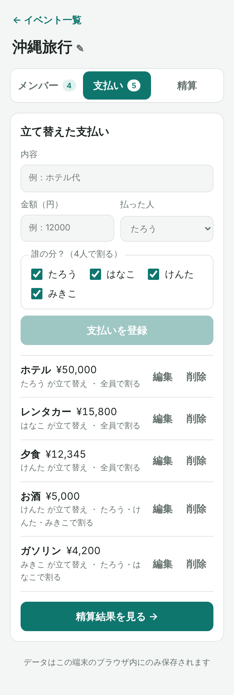
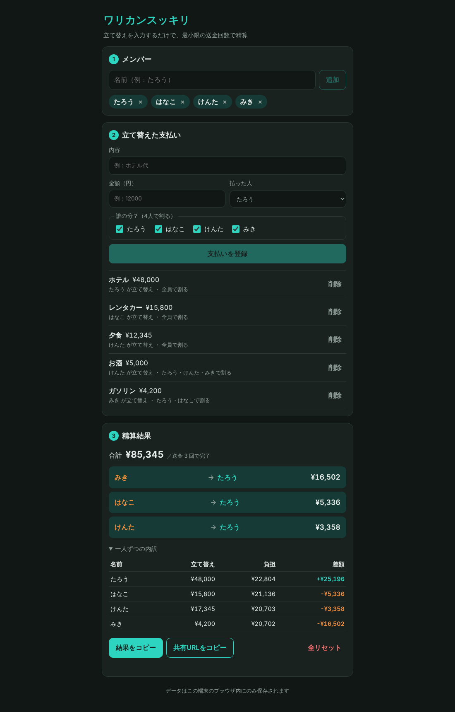

# ワリカンスッキリ 💴

旅行や飲み会で **「誰が・何に・いくら立て替えたか」** を入力するだけで、
**最小限の送金回数で精算できる「誰 → 誰：いくら」リスト** を出す割り勘精算アプリです。
ログイン不要・インストール不要。データはブラウザの中だけに保存されます。

- 公開 URL: https://warikan-settle.vercel.app
- 記事: （公開後に追記）

| トップ（イベント一覧） | 精算タブ（幹事） | 共有ビュー（参加者） |
|---|---|---|
|  |  |  |

<details>
<summary>支払い入力・PC／ダークモード表示</summary>



</details>

## 誰のため？
| ペルソナ | 困りごと | このアプリで |
|---|---|---|
| **幹事**（立て替えをまとめる人） | 立て替えが複数人・複数回に分かれると計算が面倒で、送金回数も多い | 支払いを入力するだけで最小回数の送金リスト。誰が払い終えたかもチェックできる |
| **参加者**（リンクを受け取る人） | 結局自分はいくら・誰に払えばいいか分からない | リンクを開いて名前を選ぶだけで、自分の送金額と相手が大きく表示される |

## 主な機能
- **イベント管理**：旅行・飲み会ごとにイベントを作成。一覧で合計・人数・精算状況が分かる
- **メンバー**：追加・名前変更・削除
- **支払い**：内容・金額・払った人・**誰の分か**（「お酒は飲んだ人だけ」のような一部割り）を登録、編集・削除
- **精算**：最小に近い送金回数のリスト（N 人なら最大 N−1 回）、一人ずつの内訳、送金ごとの **精算済みチェック**
- **共有**：参加者用の閲覧ページへのリンク（スマホの共有シート対応）、LINE に貼れるテキストのコピー
- **参加者用ページ**：「あなたは誰？」で自分を選ぶと、自分の送金を強調表示。金額コピー、端末への取り込み
- ブラウザへの自動保存、ダークモード、スマホ対応

## ページ構成
```
トップ（/）
└── イベント詳細（/events/:id）
    ├── メンバー（?tab=members）
    ├── 支払い  （?tab=expenses）
    └── 精算    （?tab=settle）

共有ビュー（/share#s=…）※参加者向け。共有リンクからのみ開く
```

## 技術スタック
| 分類 | 使用技術 |
|------|----------|
| フロントエンド | React 19 / TypeScript / Vite |
| ルーティング | History API（ライブラリなし）＋ Vercel rewrite |
| データ保存 | localStorage ／ URL ハッシュ（サーバー・DB なし） |
| テスト | Vitest（精算・保存・reducer・ルーティングの単体テスト 29 件） |
| Lint | oxlint |
| E2E 確認・スクショ | Playwright |
| ホスティング | Vercel（静的サイト） |
| 開発 | Claude Code（`/init`・CLAUDE.md・Plan Mode） |

## 精算のしくみ
1. 各支払いを対象者で割る。割り切れない端数は先頭の人から 1 円ずつ配り、**合計が必ず支払額と一致**するようにする
2. メンバーごとに「立て替えた額 − 負担すべき額」＝差額を出す（全員の合計は必ず 0）
3. 受け取る人・払う人をそれぞれ金額の大きい順に並べ、最大同士を相殺していく（貪欲法）

ロジックは `src/lib/settle.ts` の純粋関数で、「精算どおりに送金すると全員 0 円になる」ことをテストで検証しています。

## プライバシー
- データは端末のブラウザ（localStorage）にのみ保存されます
- 共有リンクはイベントの内容を URL の `#` 以降に埋め込みます。`#` 以降はサーバーに送信されませんが、**リンクを知っている人は内容を見られます**

## 開発
```bash
npm install
npm run dev      # 開発サーバー
npm test         # 単体テスト
npm run lint     # Lint
npm run build    # 型チェック + 本番ビルド
```

## ドキュメント
| ファイル | 内容 |
|---|---|
| [docs/requirements.md](docs/requirements.md) | 要件定義書（T-06） |
| [docs/user-story-map.md](docs/user-story-map.md) | ユーザーストーリーマップ（T-04）＋[図](docs/user-story-map.png) |
| [docs/information-architecture.md](docs/information-architecture.md) | サイトマップ・ページ一覧（T-05） |
| [docs/plan.md](docs/plan.md) / [docs/plan-v1.0.md](docs/plan-v1.0.md) | Plan Mode で作った設計書（MVP / v1.0） |
| [CLAUDE.md](CLAUDE.md) | Claude Code 用のプロジェクトルール |

## ライセンス
MIT
