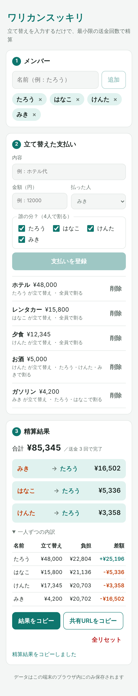

# ワリカンスッキリ 💴

旅行や飲み会で **「誰が・何に・いくら立て替えたか」** を入力するだけで、
**最小限の送金回数で精算できる「誰 → 誰：いくら」リスト** を出す割り勘精算アプリです。
ログイン不要・インストール不要。データはブラウザの中だけに保存されます。

- 公開 URL: https://YOUR-VERCEL-URL.vercel.app
- 記事: （公開後に追記）



<details>
<summary>PC・ダークモード表示</summary>


</details>

## 誰のため？
友人・家族・サークルの旅行や飲み会で **幹事をする人**。
立て替えが複数人・複数回に分かれると「結局だれが誰にいくら？」の計算が面倒で間違えやすい、という課題を解決します。

## 主な機能
- メンバーの追加・削除
- 支払いの登録（内容・金額・払った人・**誰の分か**）— 「お酒は飲んだ人だけ」のような一部割りに対応
- 一人ずつの内訳（立て替え額・負担額・差額）
- 最小限に近い送金回数の精算リスト（N 人なら最大 N−1 回）
- 結果をテキストでコピー（LINE にそのまま貼れる）
- 共有 URL（入力内容を URL ハッシュに埋め込み。サーバーには送信されません）
- ブラウザへの自動保存、ダークモード、スマホ対応

## 技術スタック
| 分類 | 使用技術 |
|------|----------|
| フロントエンド | React 19 / TypeScript / Vite |
| テスト | Vitest（精算ロジック・保存形式の単体テスト） |
| Lint | oxlint |
| E2E 確認・スクショ | Playwright |
| ホスティング | Vercel（静的サイト） |
| 開発 | Claude Code（`/init`・CLAUDE.md・Plan Mode） |

サーバー・DB はありません。状態は `localStorage` と URL ハッシュだけで扱います。

## 精算のしくみ
1. 各支払いを対象者で割る。割り切れない端数は先頭の人から 1 円ずつ配り、**合計が必ず支払額と一致**するようにする
2. メンバーごとに「立て替えた額 − 負担すべき額」＝差額を出す（全員の合計は必ず 0）
3. 受け取る人・払う人をそれぞれ金額の大きい順に並べ、最大同士を相殺していく（貪欲法）

ロジックは `src/lib/settle.ts` の純粋関数で、`src/lib/settle.test.ts` で「精算どおりに送金すると全員 0 円になる」ことを検証しています。

## 開発
```bash
npm install
npm run dev      # 開発サーバー
npm test         # 単体テスト
npm run lint     # Lint
npm run build    # 型チェック + 本番ビルド
```

## ディレクトリ
```
src/
  lib/         計算・保存などの純粋ロジック（テスト付き）
  components/  画面の 3 セクション（メンバー / 支払い / 精算結果）
docs/
  requirements.md  要件定義書
  plan.md          Plan Mode で作った設計書
CLAUDE.md          Claude Code 用のプロジェクトルール
```

## ライセンス
MIT
