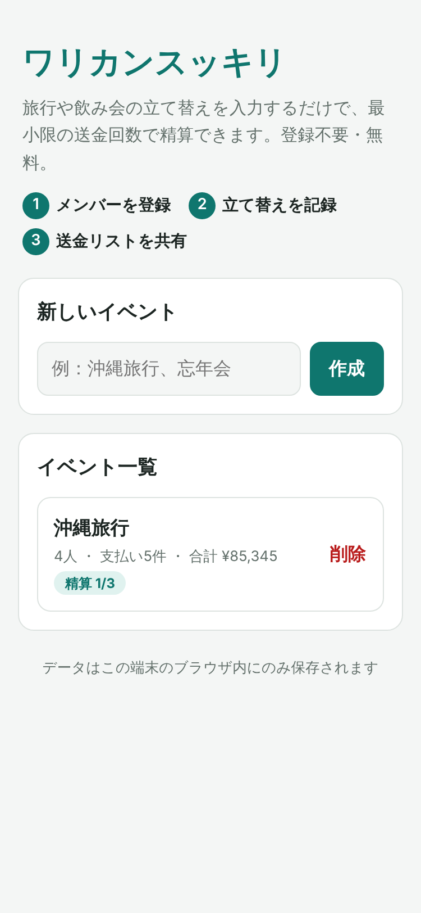
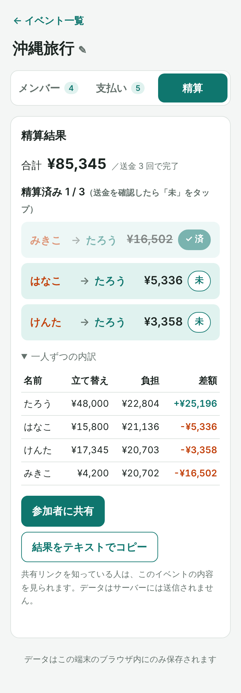
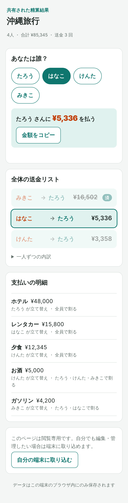
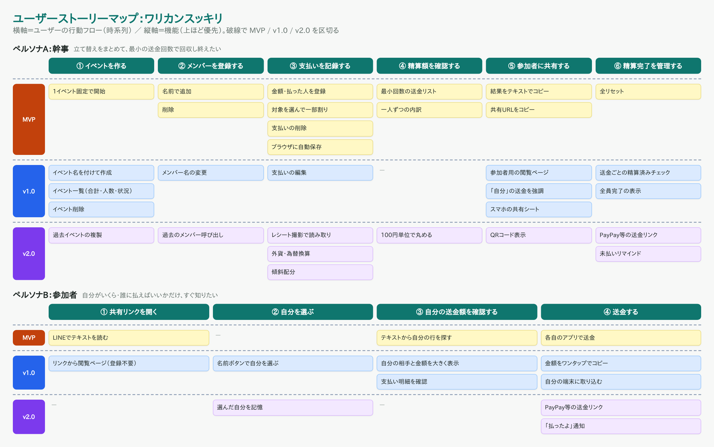

# 【Claude Code】旅行の割り勘を「最小の送金回数」で精算するアプリ「ワリカンスッキリ」を作った

## 作ったもの
旅行や飲み会で立て替えた支払いを入力するだけで、**「誰 → 誰：いくら」払えば精算が終わるか** を出す Web アプリです。
ログイン不要・インストール不要で、スマホのブラウザからすぐ使えます。

- 公開 URL：https://warikan-settle.vercel.app
- GitHub：https://github.com/saitaka29-stack/warikan-settle

| トップ | 精算（幹事） | 共有ビュー（参加者） |
|---|---|---|
|  |  |  |

### できること
- 旅行・飲み会ごとに **イベント** を作って管理（一覧で精算状況が分かる）
- メンバーと支払い（内容・金額・払った人・誰の分か）を登録。「お酒は飲んだ人だけで割る」のような **一部のメンバーだけの割り勘** に対応
- **最小に近い送金回数の精算リスト**（4 人なら最大 3 回）と、送金ごとの **精算済みチェック**
- **参加者用の共有ページ**：リンクを開いて「あなたは誰？」で名前を選ぶと、自分が誰にいくら払うかが大きく表示される
- 入力内容はブラウザに自動保存（サーバーには送らない）

## 誰のため？
| ペルソナ | 困りごと |
|---|---|
| **幹事**（友人旅行や飲み会でいつも立て替える人） | 「ホテル代は A さん、レンタカーは B さん、夕食は C さん、お酒は飲んだ人だけ…」と立て替えが入り組むと、最後の精算でスプレッドシートとにらめっこ。全員が全員に送金すると回数も多い |
| **参加者**（LINE でリンクを受け取る人） | 計算は任せたいが「結局自分はいくら、誰に払えばいいの？」が分からない。アプリの登録やインストールはしたくない |

## 要件定義の流れ（T-04〜T-06）
最初は「幹事が 1 画面で入力して精算リストを出す」MVP を作りました。その後、ユーザーストーリーマップ → 情報設計 → 要件定義書の順に整理し直したところ、2 つの見落としに気づきました。

### T-04 ユーザーストーリーマップ
行動フロー（バックボーン）をペルソナ別に書き、機能を MVP / v1.0 / v2.0 に分けました。



- 幹事：イベントを作る → メンバーを登録する → 支払いを記録する → 精算額を確認する → 参加者に共有する → **精算完了を管理する**
- 参加者：共有リンクを開く → 自分を選ぶ → 自分の送金額を確認する → 送金する

**気づき①**：MVP は幹事のことしか考えておらず、**参加者は貼られたテキストから自分の行を探すしかなかった**。また、幹事の「最後まで回収し終える」という⑥がまるごと抜けていた。

### T-05 情報設計（サイトマップ）
```
トップ（/）……………… イベント一覧
└── イベント詳細（/events/:id）
    ├── メンバー / 支払い / 精算（タブ）
共有ビュー（/share#s=…）… 参加者用。リンクからのみ開く
```
**気づき②**：幹事のメンタルモデルは「旅行ごとに精算する」なので、**イベントを入れ物にする**のが自然。階層は 3 層以内、精算までトップから 2 クリック、参加者はリンクを開くだけ（0 クリック）で結果に着く構成にしました。

### T-06 要件定義書
テンプレート（概要 / ユーザーストーリー / 機能要件 / 非機能要件 / 制約条件 / 画面遷移 / 参考デザイン）に沿って、機能を F-01〜F-18 として Phase 付きで整理しました。
「サーバーに送らない」「金額は整数円・合計は必ず一致」なども非機能要件・制約として明文化しています。

## 技術スタック
| 分類 | 使用技術 |
|------|----------|
| フロントエンド | React 19 / TypeScript / Vite |
| ルーティング | History API（ライブラリなし）＋ Vercel の rewrite |
| データ保存 | localStorage ／ URL ハッシュ（サーバー・DB なし） |
| テスト | Vitest（29 件） |
| Lint | oxlint |
| 動作確認・スクショ | Playwright |
| ホスティング | Vercel |

**サーバーも DB も使っていません。** 共有リンクはイベントの内容を URL の `#` 以降に埋め込む方式で、`#` 以降はサーバーに送信されません。
ログインなしで個人の金銭情報を預からないため、Supabase などはあえて使いませんでした。

### 精算アルゴリズム
1. 各支払いを対象者で割る。端数は先頭の人から 1 円ずつ配り、**合計が必ず一致**するようにする
2. 一人ずつ「立て替えた額 − 負担額」＝差額を計算（全員の合計は必ず 0）
3. 受け取る人と払う人を金額の大きい順に並べ、最大同士を相殺していく（貪欲法）→ 送金は最大 N−1 回

## 使った Claude Code の機能
### 1. `/init` で CLAUDE.md を生成 → ルールを追記
`/init` で土台を作り、プロジェクト固有のルールを追記しました。効いたのはこのあたりです。
- **バックエンドを追加しない**（データはブラウザ内だけ）
- **計算ロジックは `src/lib/` の純粋関数に置き、変更したら必ずテストを更新**
- **金額は整数（円）で扱い、端数を配っても合計が必ず一致すること**
- 保存形式を変えるときは `version` を上げ、古い形式も読めるようにする

さらに、要件定義書・ストーリーマップ・サイトマップ・設計書の場所を CLAUDE.md に書いておき、
「`@docs/requirements.md` を読んで、この要件で実装を進めて」と指示すれば同じ前提で作業できる状態にしました。

### 2. Plan Mode で設計 → 確認 → 実装
いきなりコードを書かせず、Plan Mode で設計してから実装しました。
- **MVP**：データモデル・精算アルゴリズム・保存方式・画面構成・テスト項目を `docs/plan.md` に設計
- **v1.0**：T-04〜T-06 の成果物を読ませたうえで再設計し、`docs/plan-v1.0.md` を **確認・承認してから** 実装へ

v1.0 の設計では「データモデルを v2 にして旧データを移行する」「精算済みは送金キーで持ち、支払いが変わったら自然に外れるようにする」「ルーティングはライブラリなしで History API」など、
実装前に方針を決められたので、手戻りがほとんどありませんでした。

### 3. テスト・Lint・ビルド → Playwright で E2E 確認
実装順は「ロジック＋テスト → 画面 → E2E 確認」。`npm test`（29 件）→ `npm run lint` → `npm run build` を通したうえで、
Playwright で「イベント作成 → メンバー 4 人 → 支払い 5 件（編集含む）→ 精算済みチェック → 共有リンクを別ブラウザで開く → 自分を選ぶ → 取り込む」
まで実際のブラウザで確認しました。README のスクリーンショットもこのとき撮影しています。

### 4. Git ワークフロー
「Vite 作成 → 要件・CLAUDE.md・設計 → ロジック＋テスト → 画面 → ドキュメント」の区切りでコミットし、GitHub に push → Vercel と連携してデプロイしました。

## 所要時間
（ここにご自身の実績を記入：例）要件定義 ◯分／設計 ◯分／実装・テスト ◯分／デプロイ・README・記事 ◯分

## つまずいたところと解決方法
### ① 日本語を含むデータを共有 URL にすると壊れる
共有 URL は JSON → base64 にしてハッシュに入れていますが、`btoa()` は日本語を直接扱えず例外になります。
→ `TextEncoder` で UTF-8 のバイト列にしてから base64url に変換。「日本語・絵文字を含むイベントを往復できる」テストを追加しました。

### ② 割り切れない金額で合計が合わない
10,000 円を 3 人で割ると 3,333.33… 円。四捨五入すると合計が 9,999 円になります。
→ 全員に切り捨て額を配り、余りを先頭の人から 1 円ずつ配る方式に統一し、CLAUDE.md にもルールとして書きました。

### ③ 支払いを直したら「精算済み」チェックが嘘になる
精算済みを「何番目の送金か」で持つと、支払いを編集して送金内容が変わっても、チェックだけ残ってしまいます。
→ チェックを「送る人 > 受け取る人 : 金額」というキーで持つように設計。送金内容が変わればキーが一致しなくなり、**自動でチェックが外れる**ようにしました（テストで確認）。

### ④ MVP 版のデータが新しい形式で読めなくなる
複数イベント対応で保存形式が変わるため、MVP 版で入力したデータや、すでに送った共有リンクが開けなくなる問題がありました。
→ 保存形式に `version` を持たせ、v1 のデータは「マイイベント」として自動移行。共有リンクも v1・v2 の両方を読めるようにしました。
なお E2E テストで一度「移行されない」と失敗しましたが、原因はテスト手順側（先にページを開いたため空の v2 データが保存されていた）で、初回アクセス前にデータを仕込む形に直して確認しました。

### ⑤ 型名 `Event` が DOM の `Event` とぶつかる
「イベント」をそのまま `Event` 型にすると、ブラウザ標準の `Event` 型と紛らわしく、import 漏れでも型エラーになりません。
→ `EventData` という名前にし、理由を CLAUDE.md に書いておきました。

### ⑥ SPA の直アクセスが Vercel で 404 になる
`/events/xxx` や `/share` を直接開くと、静的ホスティングでは該当ファイルがなく 404 になります。
→ `vercel.json` で全パスを `index.html` に rewrite。アプリ側でも、存在しないイベントや URL はトップに戻すようにしました。

### ⑦ 作業セッションが途中で再起動して Plan Mode が解除された
クラウド環境で作業していたため、MVP の設計中にセッションが再起動して Plan Mode が抜けてしまいました。
→ 設計内容を `docs/plan.md` としてリポジトリに残して実装を続け、v1.0 では Plan Mode で設計 → 承認 → 実装の流れをやり直しました。

## まとめ
最初に作った MVP は「計算機」としては動いていましたが、T-04〜T-06 でペルソナと行動フローを書き出すと、
**参加者の体験**と**回収し終えるまでの管理**が抜けていたことに気づけました。
要件定義書と CLAUDE.md でルールを先に決め、Plan Mode で設計してから実装する流れにしたことで、
お金の計算という間違えられない部分をテストで守りながら、機能を広げられました。

## リンク
- 公開 URL：https://warikan-settle.vercel.app
- GitHub：https://github.com/saitaka29-stack/warikan-settle
