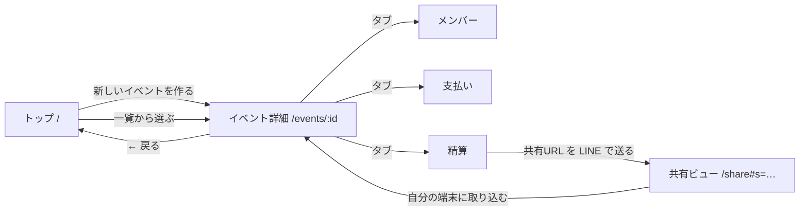

# T-05 情報設計（IA）：ワリカンスッキリ

## 設計方針（ユーザーのメンタルモデル）
- 幹事は「旅行（イベント）ごとに精算する」と考えるので、**イベントを入れ物にして、その中にメンバー・支払い・精算を置く**
- 入力の順番は「メンバー → 支払い → 精算」なので、イベント詳細のタブもこの順に並べる
- 参加者は「リンクを開いたら自分の金額が知りたいだけ」なので、**入力画面を見せない専用ページ**に分ける
- ログインはないので「マイページ」は作らない。トップのイベント一覧がその役割を兼ねる

## ① サイトマップ

```
トップ（/）……………………………… 幹事の入口：サービス紹介 + イベント一覧
└── イベント詳細（/events/:id）… 1 つのイベントの入力と精算
    ├── メンバー（?tab=members）
    ├── 支払い  （?tab=expenses）
    └── 精算    （?tab=settle）

共有ビュー（/share#s=…）…………… 参加者の入口：LINE などで届いたリンクからのみ開く
└──（「自分の端末に取り込む」→ イベント詳細へ）
```

- 階層は **最大 3 層**（トップ → イベント詳細 → タブ）
- 存在しない URL・削除済みイベントはトップに戻す

### 画面遷移


## ② ページ一覧表

| ページ名 | URL | 対象 | 目的 | 主要機能 |
|---|---|---|---|---|
| トップ | `/` | 幹事 | サービス紹介・イベントの入口 | 使い方 3 ステップ / 新しいイベントを作る / イベント一覧（名前・人数・合計・精算状況）/ イベント削除 |
| イベント詳細：メンバー | `/events/:id?tab=members` | 幹事 | 割り勘する人を決める | イベント名の変更 / メンバー追加・名前変更・削除 |
| イベント詳細：支払い | `/events/:id?tab=expenses` | 幹事 | 立て替えを記録する | 支払い登録（内容・金額・払った人・誰の分）/ 一覧 / 編集 / 削除 |
| イベント詳細：精算 | `/events/:id?tab=settle` | 幹事 | 誰が誰にいくら払うかを出し、回収を管理する | 送金リスト / 精算済みチェック / 一人ずつの内訳 / 結果コピー / 共有（URL・共有シート） |
| 共有ビュー | `/share#s=…` | 参加者 | 自分の送金額と送金先をすぐ知る | 「自分」を選ぶ / 自分の送金を強調 / 金額コピー / 全体の送金リスト / 支払い明細 / 自分の端末に取り込む |

## 評価観点のセルフチェック

| 観点 | 結果 |
|---|---|
| 階層が 3 層以内か | ○ トップ → イベント詳細 → タブ の 3 層 |
| 重要な機能に 2 クリック以内で行けるか | ○ トップ →（1）イベント →（2）精算タブ。参加者は**リンクを開くだけ**（0 クリック）で精算結果に着く |
| ナビゲーションに一貫性があるか | ○ イベント詳細は常に同じ順のタブ（メンバー / 支払い / 精算）と「← イベント一覧」。タブの状態は URL に持つので、再読み込みや戻るボタンでも迷わない |
| メンタルモデルに沿っているか | ○ 「旅行ごと」にまとめ、入力順にタブを並べ、参加者には入力画面を見せない |
